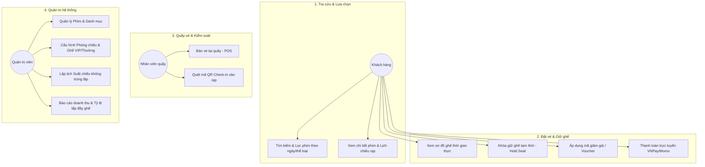
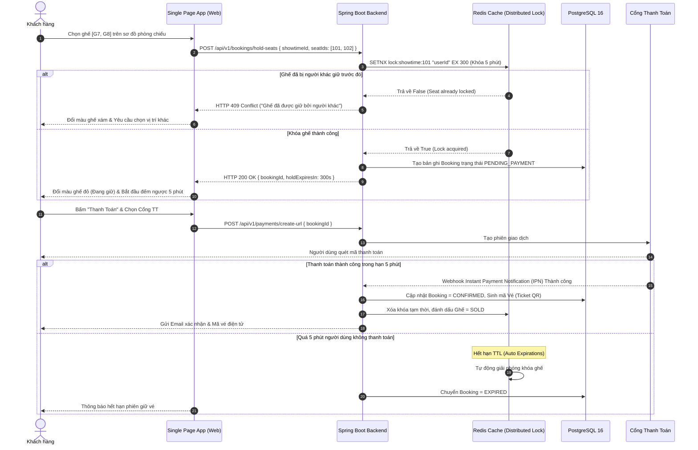
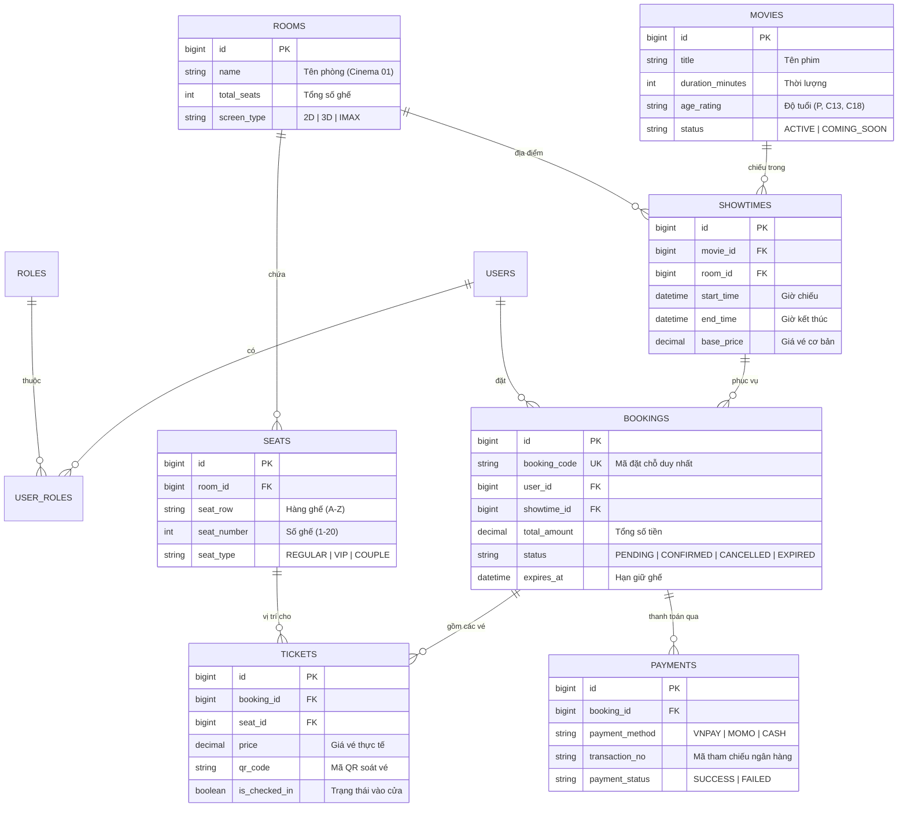

# 🎬 TÀI LIỆU ĐẶC TẢ YÊU CẦU PHẦN MỀM (SRS & BA SPECIFICATION)
## DỰ ÁN: CINEMA 8 STAR — HỆ THỐNG ĐẶT VÉ XEM PHIM TRỰC TUYẾN

- **Mã hệ thống:** `CINEMA-MANAGER-2025`
- **Tác giả / Lead BA & System Architect:** Nguyễn Văn Dũng
- **Khoa / Trường:** Khoa Công nghệ Thông tin — Đại học Công nghiệp Hà Nội (HaUI)
- **Phiên bản:** `v1.3.0` (Cập nhật tháng 11/2026)

---

## 1. TỔNG QUAN HỆ THỐNG (SYSTEM OVERVIEW)

### 1.1. Bối cảnh & Mục tiêu nghiệp vụ
Hệ thống bán vé rạp chiếu phim trực tuyến đòi hỏi tính toàn vẹn dữ liệu cực cao tại thời điểm người dùng chọn ghế và thanh toán. Vấn đề nhức nhối nhất của các rạp phim là **xung đột ghế (Seat Concurrency Conflict)**: khi có 2 hoặc nhiều khách hàng cùng bấm chọn 1 vị trí ghế VIP trong cùng một phần nghìn giây.

### 1.2. Giải pháp cốt lõi
Thiết kế quy trình nghiệp vụ hai bước: **Giữ chỗ tạm thời (Seat Locking với Redis TTL 5-10 phút)** kết hợp **Giao dịch thanh toán an toàn (ACID Transaction trên PostgreSQL)**, đảm bảo ghế đã giữ không bị người khác tranh chấp trong lúc thanh toán.

---

## 2. MA TRẬN PHÂN QUYỀN & SƠ ĐỒ USE CASE (USE CASE SPECIFICATION)

### 2.1. Phân quyền tác nhân (Role-Based Access Control)
- **Khách hàng (Customer / End-User):** Tra cứu phim, xem trailer, chọn rạp/suất chiếu, chọn ghế theo sơ đồ thời gian thực, áp dụng voucher khuyến mãi, thanh toán vé.
- **Nhân viên rạp (Staff / Cashier):** Xuất vé tại quầy (Box Office), quét mã QR vé vào phòng chiếu, hỗ trợ đổi trả vé theo quy định.
- **Quản trị viên (Cinema Admin):** Quản lý phim, cấu hình phòng chiếu & sơ đồ ghế, lên lịch suất chiếu (Showtime scheduling), quản lý mã giảm giá và xem báo cáo doanh thu.

### 2.2. Sơ đồ Use Case tổng quan

---

## 3. LUỒNG NGHIỆP VỤ GIỮ GHẾ & THANH TOÁN (SEAT LOCKING ACTIVITY DIAGRAM)

---

## 4. MÔ HÌNH DỮ LIỆU THỰC THỂ QUAN HỆ (ERD CHUẨN 3NF)

---

## 5. QUY TẮC NGHIỆP VỤ & ĐẶC TẢ API (BUSINESS RULES & API)

### 5.1. Quy tắc nghiệm thu (Business Rules)
1. **Quy tắc xếp lịch:** Hai suất chiếu cùng phòng phải cách nhau tối thiểu **15 phút** (Thời gian dọn phòng chiếu và phát quảng cáo dạo đầu).
2. **Quy tắc giữ chỗ (TTL Rule):** Thời gian giữ chỗ tối đa là **300 giây (5 phút)**. Nếu cổng thanh toán không phản hồi thành công trong thời gian này, ghế sẽ tự động mở lại cho người khác.
3. **Quy tắc giá vé:** 
   - Ghế VIP: Giá vé = `base_price` + 20%.
   - Ghế đôi (Couple): Giá vé = `base_price` * 2.
   - Suất chiếu sau 18:00 và cuối tuần phụ thu thêm 10%.

### 5.2. Danh sách API then chốt
- `GET /api/v1/movies/now-showing`: Danh sách phim đang chiếu kèm suất chiếu trong ngày.
- `GET /api/v1/showtimes/:id/seat-layout`: Lấy sơ đồ ghế kèm trạng thái thời gian thực (`AVAILABLE`, `HOLDING`, `BOOKED`).
- `POST /api/v1/bookings/hold-seats`: Khóa giữ ghế tạm thời trong 5 phút.
- `POST /api/v1/bookings/:id/confirm`: Xác nhận thanh toán và tạo mã vé QR.

---

## 6. YÊU CẦU PHI CHỨC NĂNG (NFR)
- **Tính toàn vẹn (Data Consistency):** Áp dụng mức cô lập giao dịch `READ_COMMITTED` kết hợp Distributed Lock trên Redis, ngăn ngừa 100% tình trạng over-booking (bán trùng ghế).
- **Thời gian phản hồi (Response Time):** API tra cứu sơ đồ ghế có độ trễ < 80ms nhờ bộ nhớ đệm Redis Cache.
- **Tính sẵn sàng (High Availability):** Thiết kế Stateless API hỗ trợ mở rộng ngang (Horizontal Scaling) khi lưu lượng khách đặt vé tăng đột biến trong các dịp phim bom tấn phát hành.

---
*Tài liệu chuẩn hóa phục vụ thẩm định phân tích nghiệp vụ và kiến trúc hệ thống Cinema-Manager.*
